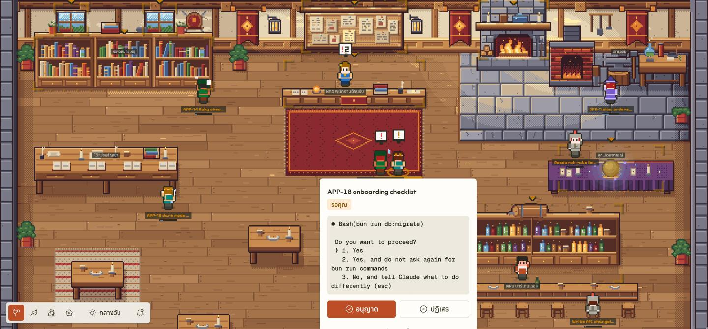
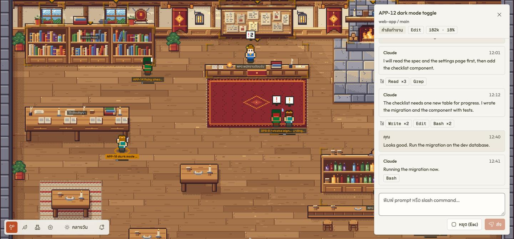
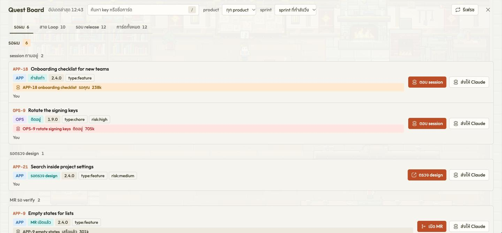
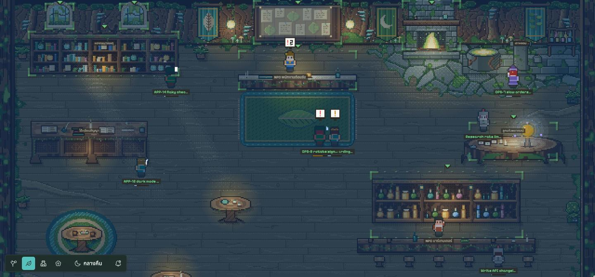
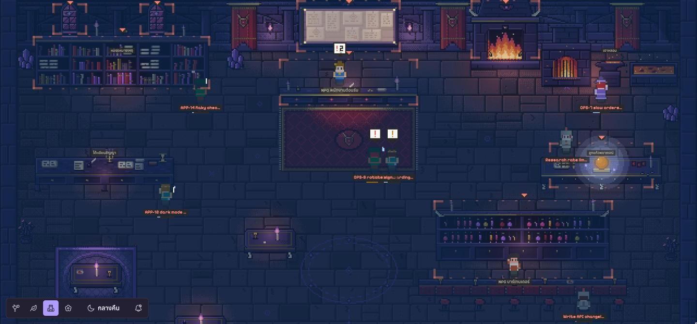
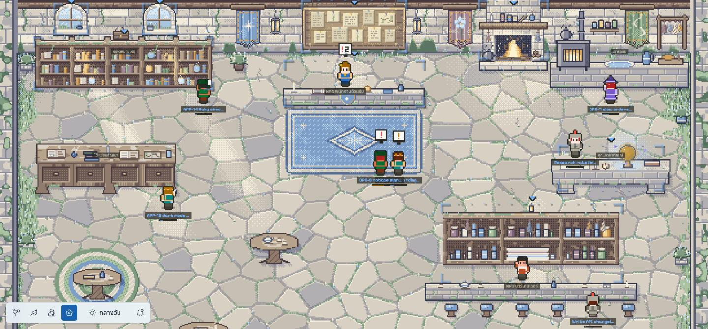

# Isekai Office

  

> **Work in progress.** Things move and break. The UI text is in Thai.

A pixel-art guild hall that shows your AI coding agent sessions as characters. Each session walks to the station that matches what it is doing, raises a `!` when it needs you, and you answer it from the room.


## What it looks like

| Answer a waiting agent from the room | Read a session's chat history |
|---|---|
|  |  |

| Quest board: what waits for you | Four worlds, day and night |
|---|---|
|  |  |

| Demon Lord's Keep | Starfall Meadow |
|---|---|
|  |  |

All screenshots use the built-in demo data.

## What it does

- **The room is the menu.** The quest board, reception desk, windows, door, crystal orb, bar shelf, hearth and bookshelves are all clickable. Hold `?` to see every one.
- **Agents go where the work is.** Editing sends a character to the desk, reading to the archive, searching to the crystal orb, running commands to the forge.
- **Waiting agents ask for you.** The tab title counts them, a bell turns on browser notifications, and a popover on the character shows the terminal prompt with allow and deny.
- **Chat history.** Open any agent to read its conversation, with tool calls folded into one line.
- **Quest board.** An inbox of what waits for you, the stages of an agent loop, and a release checklist.
- **Four worlds**, each with a day and a night.

## Try it

You need [Bun](https://bun.sh).

```bash
bun install
bun run demo
```

Open `http://localhost:4310`. Demo mode serves made-up sessions and cards, so nothing else has to be installed.

## Use it with real sessions

The live feed reads agent sessions from the [Orca](https://orca.app) desktop app on macOS and their transcripts from `~/.claude/projects`. The quest board reads a task tracker over MCP.

```bash
cp .env.example .env.local
bun run dev
```

`.env.local` holds `WORKSPACE_URL` (your tracker) and `BOARD_SPACES` (the project keys to show). Without them the room still works and the board shows an error.

## Checks

```bash
bun run check
```

Runs typecheck, tests and the build.

## Built with

Bun, React 19, Vite, Tailwind 4, radix-ui and a small canvas 2D engine. The room art is drawn by the Python scripts in `design/rooms`.
