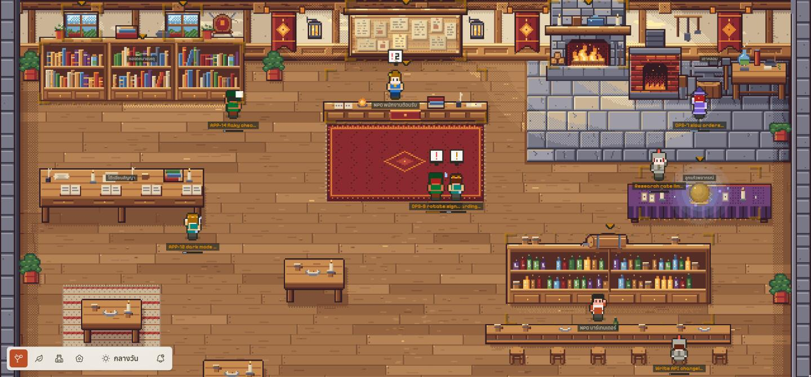

# Isekai Office

   

> **Work in progress.** Things move and break. The UI text is in Thai.

A pixel-art guild hall that shows your AI coding agent sessions as characters. Each session walks to the station that matches what it is doing, raises a `!` when it needs you, and you answer it from the room.

It is built to sit open all day next to the agents it watches, so it stays small: the whole server runs in about **16 MB** of memory.



## What it looks like

| Answer a waiting agent from the room | Read a session's chat history |
|---|---|
|  |  |

| Quest board: what waits for you | Four worlds, day and night |
|---|---|
|  |  |

| Demon Lord's Keep | Starfall Meadow |
|---|---|
|  |  |

All screenshots use the built-in demo data.

## What it does

- **The room is the menu.** The quest board, reception desk, windows, door, crystal orb, bar shelf, hearth and bookshelves are all clickable. Hold `?` to see every one.
- **Agents go where the work is.** Editing sends a character to the desk, reading to the archive, searching to the crystal orb, running commands to the forge.
- **Waiting agents ask for you.** The tab title counts them, a bell turns on browser notifications, and a popover on the character shows the terminal prompt with allow and deny.
- **Chat history.** Open any agent to read its conversation, with tool calls folded into one line.
- **Quest board.** An inbox of what waits for you, the stages of an agent loop, and a release checklist.
- **Quest templates.** Saved first prompts for the door form, with `{{name}}`, `{{repo}}` and `{{branch}}` placeholders. They live in `<data dir>/templates.json` (`GET` and `PUT /api/templates`); three built-ins are used until you save a list.
- **Session archive.** The bookshelves list past sessions, including ones that left the room. Search them, read a transcript, copy its first prompt, or save it as a quest template. See [Session archive](#session-archive).
- **Four worlds**, each with a day and a night.

## Light on memory

Agent sessions already use most of the machine. This should not add to it.

| What | Measured |
|---|---|
| Server memory, live (5 sessions, 60 board cards) | 16 MB |
| Server memory, demo mode | 9 MB |
| Server memory, peak at startup | 57 MB |
| JavaScript sent to the browser | 145 KB gzipped |
| CSS | 21 KB gzipped |
| All four room backdrops | 300 KB |

Memory is the physical footprint reported by macOS `footprint` for the Bun 1.4 process, on an Apple Silicon Mac. Your numbers will differ with the number of sessions.

How it stays small:

- **One Bun process.** No database, no queue, no Electron. State lives in the tools it reads from.
- **It only works while you look.** The server polls for sessions only while a browser tab is connected, and stops when the last one closes.
- **The guild log is a file, not a database.** While a tab is open, each tick appends to `<data dir>/log/YYYY-MM-DD.jsonl` (data dir: `ISEKAI_DATA_DIR`, default `~/.isekai-office`). Days older than `LOG_KEEP_DAYS` (14) are deleted, and station events stop for a day past `LOG_DAY_MAX_BYTES` (5 MB). Session titles are stored in plain text.
- **The canvas sleeps.** Drawing stops when the tab is hidden or the quest board covers the room.
- **Transcripts are read once.** A session file is parsed again only when its size or modified time changes, and at most 200 entries are kept.
- **Rooms are pictures.** Each world is one 640x384 PNG drawn ahead of time, not a scene built at run time.

## Token bill

The bar shelf has a `บิล` tab with the token spend of each session and of the day. It reads the same transcripts as the local source and counts every `message.id` once.

Prices are not in the source, because they change. Copy `pricing.example.json` to `<data dir>/pricing.json` (`ISEKAI_DATA_DIR`, default `~/.isekai-office`) and fill it in from your provider's pricing page. Each number is the price per million tokens, and the first entry whose `match` is part of the model name is used. Without the file, or for a model with no entry, the tab shows tokens and no cost. 1 gold is 0.01 of the currency. The value is the API price for the tokens, not what a monthly plan charges.

## Try it

You need [Bun](https://bun.sh).

```bash
bun install
bun run demo
```

Open `http://localhost:4310`. Demo mode serves made-up sessions and cards, so nothing else has to be installed.

## Use it with real sessions

The live feed reads agent sessions from the [Orca](https://orca.app) desktop app on macOS and their transcripts from `~/.claude/projects`. Without Orca it reads the transcripts alone, see [Run without Orca](#run-without-orca). The quest board reads a task tracker over MCP.

```bash
cp .env.example .env.local
bun run dev
```

`.env.local` holds `WORKSPACE_URL` (your tracker) and `BOARD_SPACES` (the project keys to show). Without them the room still works and the board shows an error.

`bun run dev` starts the server with `--watch` and Vite, on any OS, and stops both when you press Ctrl+C. On macOS `bun run dev:service` keeps the old flow that pauses the launchd service while you develop.

## Run without Orca

On Windows, Linux, or a Mac without Orca, the room reads the transcripts Claude Code writes to `~/.claude/projects`. Nothing else has to be installed.

```bash
SESSION_SOURCE=local bun run start
```

`SESSION_SOURCE` is `orca`, `local` or `auto`. `auto` is the default: Orca when its binary exists, otherwise the local source. `LOCAL_RECENT_MINUTES` (default 60) is how long a session stays in the room after its last write.

What the local source can do:

- Every Claude Code session you started in any folder shows up within a tick of its first write, titled by its name or summary, and leaves the room after `LOCAL_RECENT_MINUTES` of silence.
- A session whose last message is from Claude with no tool call is `done`. One with a tool call or a prompt in flight is `working`, at the station for that tool.
- Chat history opens as usual.
- It is read only. The composer, quick reply, compact button and the new session form are disabled with the reason, and `POST /api/command` and `POST /api/spawn` answer `409 read_only_source`. Answering prompts or starting sessions needs a terminal the server owns, which is a follow-up.

### Know when Claude is waiting for you

A transcript cannot tell a tool that is running from one stopped at a permission prompt. Claude Code hooks can. Print the snippet:

```bash
bun run hooks
```

and paste the `hooks` object it prints into `~/.claude/settings.json`, merging it with hooks you already have. The command only prints; it never edits that file. Each hook runs `scripts/hook.ts`, which posts the event to the room and always exits 0 within a second, so a closed room never fails a Claude Code turn. If the room is not on port 4300, set `ISEKAI_PORT` where Claude Code runs.

With the hooks in place a permission prompt turns the character to `waiting`, answering it turns it back to `working`, and an idle notification leaves a finished session at the bar. Without them everything else still works; the room just never shows `waiting`.

## Session archive

The bookshelves have two tabs. `เซสชันเก่า` (the default) lists past Claude Code sessions from `~/.claude/projects`, newest first. `ประวัติ Loop` shows the quest board loop history. The archive reads the same folder with or without Orca, and in demo mode it serves five made-up sessions instead.

- **Search.** Type in the search box or pick a repo. The search matches a title or repo name by case-insensitive substring. The repo filter is an exact match. Typing waits 200 ms before it asks the server.
- **Active badge.** A session that is in the room now shows `อยู่ในห้อง`.
- **Read-only transcript.** Opening a session shows its chat history with a `กลับ` button. It sends no commands.
- **Copy first prompt.** `คัดลอกคำสั่งแรก` copies the first user message to the clipboard.
- **Save as template.** `บันทึกเป็นแม่แบบ` adds the first prompt to the quest templates. The name is cut to 40 characters, ending in `…` when it is longer, and the prompt to 4,000. The list holds 30 templates; a full list shows `แม่แบบเต็มแล้ว`.

| Route | Result |
|---|---|
| `GET /api/archive?q=&repo=&limit=` | `{ sessions, total, truncated }`. `limit` defaults to 30 and is clamped to 1..50. |
| `GET /api/archive/:id` | `{ id, entries, screen: null }`. `400 bad_request` for a bad id, `404 session_not_found` for an unknown one. |

The id is the transcript file name without `.jsonl`. It may hold `A-Z a-z 0-9 . _ -` and is at most 128 characters. The server looks the id up among the files it found, so a request cannot read a file outside `~/.claude/projects`.

How the scan works:

- **On request only.** Each request scans the folder. No timer runs and no database is used.
- **Tail only.** A title and a repo come from the last 256 KB of each transcript.
- **Bounded cache.** Those facts are cached for at most 200 transcripts, keyed by path, modified time and size. Past 200, the oldest entries are evicted and later searches read them again.
- **Cheap list, full search.** Without `q` or `repo`, only the newest `limit` transcripts are read. With a filter, every transcript is read.
- **No detail cache.** Opening a session reads its whole transcript each time.

## Project layout

```
server/            Bun HTTP server, one process
  main.ts            routes and static files
  guard.ts           only local requests get in
  commands/          what the browser sends to a session: command, spawn, read-only reply
  orders/            standing orders: permission rules per session
  templates/         quest templates
  archive/           session archive: scan, search, read one transcript
  feeds/             what the browser asks for: office, board, demo data
  sources/           where the data comes from: Orca, local transcripts, hook hints, tracker, GitLab
  data-dir.ts        where plain files are kept
  atomic-file.ts     safe file replace
shared/types.ts    types used by both sides
web/src/
  App.tsx            wires the room, the panels and the route together
  office/            the room on a canvas
    scene/             what is where: layout, hotspots, actors, pathfinding
    draw/              how it is painted: backdrop, sprites, effects, labels
  agent/             command panel, chat history, quick reply
  alerts/            tab title count and browser notifications
  board/             quest board
  room-panels/       panels opened by objects in the room
  components/        shared UI pieces
  lib/               api client, route, theme
design/            room art scripts and the visual philosophy
scripts/           dev server, Claude Code hook client, launchd install
```

Tests sit next to the file they test (`*.test.ts`).

## Checks

```bash
bun run check
```

Runs typecheck, tests and the build. `bun run build` fails when the JavaScript loaded on first paint is over 145,000 bytes gzipped.

## Built with

Bun, React 19, Vite, Tailwind 4, radix-ui and a small canvas 2D engine. The room art is drawn by the Python scripts in `design/rooms`.
